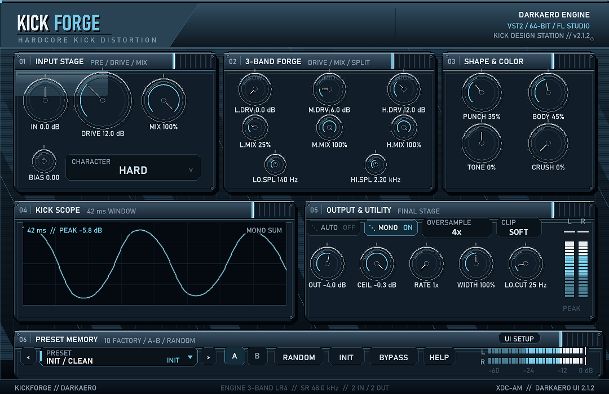
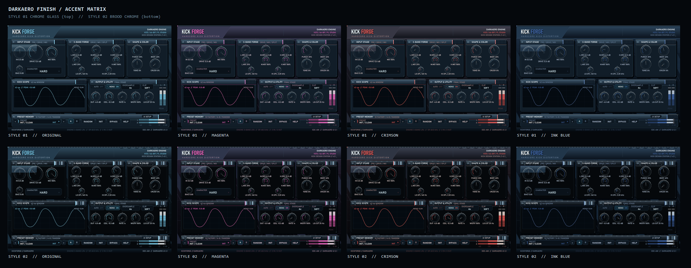

# KickForge 2.1.2 — Darkaero Hardcore Kick Distortion

KickForge is a 64-bit VST2 distortion processor for designing **Hardstyle / Rawstyle / Frenchcore / Gabber / Uptempo / Hardcore** kicks. It splits the input into LOW / MID / HIGH bands, shapes each band with its own nonlinear curve, then applies punch, body, tone, bitcrush, mono, low-cut, and a final ceiling.

KickForge 是一款用于制作 **Hardstyle / Rawstyle / Frenchcore / Gabber / Uptempo / Hardcore** kick 的 64 位 VST2 失真处理器。它把输入拆成 LOW / MID / HIGH 三个频段，分别进行非线性整形，再经过 punch、body、tone、bitcrush、mono、low-cut 和最终 ceiling。

> **Credits / 制作声明**
>
> **UI design: XDC-AM.** Concept, visual direction, layout, and the Darkaero interface were designed by XDC-AM.
>
> **UI 设计：XDC-AM。** 概念、视觉方向、布局与 Darkaero 界面由 XDC-AM 本人设计。
>
> **Other work: AI-assisted.** DSP, VST2 integration, editor implementation, build/test tooling, and documentation drafts were produced with AI assistance and reviewed by XDC-AM.
>
> **其他部分：AI 辅助制作。** DSP、VST2 集成、编辑器实现、构建/测试工具与文档草稿由 AI 辅助生成，并由 XDC-AM 审核。

**License / 开源协议:** MIT. See [LICENSE](LICENSE) and [NOTICE.md](NOTICE.md).
**开源协议：** MIT，详见 [LICENSE](LICENSE) 与 [NOTICE.md](NOTICE.md)。

**Download / 下载:** [KickForge_2.1.2_win64.zip](KickForge_2.1.2_win64.zip) — DLL + README + demo WAVs + screenshots.

**下载：** [KickForge_2.1.2_win64.zip](KickForge_2.1.2_win64.zip)，内含 DLL、README、demo WAV 与界面截图。





---

## 1. Features / 功能

| English | 中文 |
|---|---|
| 27 parameters spanning input, three-band drive/mix, crossover, transient, body, tone, bitcrush, width, mono, low-cut, auto gain, oversampling, output, and ceiling. | 27 个参数，覆盖输入、三频段 drive/mix、分频、瞬态、body、tone、bitcrush、宽度、mono、低切、自动增益、过采样、输出和 ceiling。 |
| LR4 three-band crossover with independent LOW / MID / HIGH drive and mix; default 140 Hz / 2.2 kHz. | LR4 三频段分频，LOW / MID / HIGH 独立 drive 与 mix；默认 140 Hz / 2.2 kHz。 |
| Six nonlinear curves: TUBE, HARD, FOLD, DIODE, GABBER, CRUSH. | 六种非线性曲线：TUBE、HARD、FOLD、DIODE、GABBER、CRUSH。 |
| 1x / 2x / 4x / 8x oversampling with a 31-tap half-band FIR. | 1x / 2x / 4x / 8x 过采样，31-tap 半带 FIR。 |
| Punch, Body, and Tone for transient, low-shelf, and tilt control. | Punch、Body、Tone 分别控制瞬态、低频 shelf 与倾斜 EQ。 |
| Bitcrush plus sample-rate reduction, Rate 1x–32x. | Bitcrush 与降采样，Rate 1x–32x。 |
| Width, Mono, and Low Cut for stereo and sub control. | Width、Mono、Low Cut 控制立体声与超低频。 |
| Soft / Hard ceiling and adjustable output. | Soft / Hard ceiling 与可调输出。 |
| 10 factory presets, from clean to total destruction. | 10 个工厂预设，从 clean 到 total destruction。 |
| A/B compare, randomize, init, bypass, help. | A/B 对比、随机、Init、Bypass、Help。 |
| Darkaero UI with two finishes, four accent colors, and three scale settings. | Darkaero 界面，两种外观、四种强调色、三档比例。 |
| UI state saved in the project chunk and in a global settings file. | UI 状态同时写入工程 chunk 和全局设置文件。 |
| Unload-safe editor lifecycle; no stale DLL window procedure. | 卸载安全的编辑器生命周期，不残留 DLL 窗口过程。 |

---

## 2. UI 2.1.2 / 界面

The interface is drawn procedurally with Win32 GDI at 2x supersampling. No bitmap backgrounds or external theme files are loaded.

界面使用 Win32 GDI 程序化绘制，2x 超采样；不加载位图背景或外部主题文件。

### 2.1 Finishes / 外观

| Finish / 外观 | English | 中文 |
|---|---|---|
| STYLE 01 | Chrome Glass: cold glass panels, chrome edges, machined knobs. | 冷铬玻璃：冷色玻璃面板、镀铬边缘、机加工旋钮。 |
| STYLE 02 | Brood Chrome: black segmented chrome, bright index plates, knurled knobs. | 黑色分段铬甲：亮色编号牌、齿纹旋钮、分段金属。 |

### 2.2 Accent colors / 强调色

| Accent / 强调色 | English | 中文 |
|---|---|---|
| ORIGINAL | Ice blue | 冰蓝 |
| MAGENTA | Magenta | 品红 |
| CRIMSON | Crimson | 深红 |
| INK BLUE | Ink blue | 墨蓝 |

### 2.3 Scale / 比例

`100% / 125% / 150%`. Changing the scale enlarges both the editor and the host window; mouse coordinates are mapped back to the 1080x700 logical layout.

`100% / 125% / 150%`。切换比例会同时放大编辑器和宿主窗口，鼠标坐标会映射回 1080x700 的逻辑布局。

### 2.4 Theme memory / 主题记忆

Every change to scale, finish, or accent color is saved immediately to:

每次切换比例、外观或强调色，都会立即保存到：

```text
%APPDATA%\KickForge\settings.ini
```

- The file stores `scale`, `style`, and `theme`.
- New instances restore this global look automatically.
- A project chunk still stores its own UI state and overrides the global value when the project is loaded.
- If `%APPDATA%` is not writable, KickForge falls back to `KickForge.ini` next to the DLL.
- To reset the look, close the plugin and delete the settings file.

- 文件保存 `scale`、`style`、`theme`。
- 新实例会自动恢复这套全局外观。
- 工程 chunk 仍保存自己的 UI 状态；加载工程时会覆盖全局值。
- 如果 `%APPDATA%` 不可写，会回退到 DLL 同目录的 `KickForge.ini`。
- 想恢复默认外观：关闭插件，删除该设置文件。

---

## 3. Install in FL Studio / 在 FL Studio 中安装

1. Copy `KickForge.dll` to your VST2 folder. The common default is:
2. 把 `KickForge.dll` 复制到你的 VST2 目录。常见默认路径：
   ```text
   C:\Program Files\Common Files\VST2\KickForge.dll
   ```
3. Open **64-bit FL Studio**.
4. 打开 **64 位 FL Studio**。
5. Go to **Options → Manage plugins** and make sure the VST2 folder is listed.
6. 进入 **Options → Manage plugins**，确认该 VST2 目录在列表中。
7. Click **Find more plugins / Scan**.
8. 点击 **Find more plugins / Scan** 扫描。
9. Find **KickForge** in the plugin browser and load it on a kick channel.
10. 在插件浏览器中找到 **KickForge**，加载到 kick 通道。

Only `KickForge.dll` is required. No background image, theme file, or external resource is needed.

只需要 `KickForge.dll`，不需要背景图、主题文件或其他外部资源。

---

## 4. Quick start / 快速开始

| English | 中文 |
|---|---|
| Load **HARDSTYLE PUNCH** first and confirm audio. | 先载入 **HARDSTYLE PUNCH**，确认有声音。 |
| If the input kick is already loud, set Input to about -6 dB. | 如果输入 kick 已经很响，把 Input 设到约 -6 dB。 |
| Mono is ON by default, which suits kick design. | Mono 默认开启，适合 kick 制作。 |
| Oversample defaults to 4x; use 2x when CPU is tight. | Oversample 默认 4x；CPU 紧张时用 2x。 |
| Use Output and Ceiling for final peak control. | 用 Output 与 Ceiling 控制最终峰值。 |

---

## 5. Controls / 操作

| English | 中文 |
|---|---|
| Drag a knob up/down; hold **Shift** for fine adjustment. | 上下拖动旋钮；按住 **Shift** 细调。 |
| Double-click or right-click a knob to reset it. | 双击或右键旋钮恢复默认值。 |
| Mouse wheel adjusts the focused knob. | 滚轮微调当前旋钮。 |
| Click Character / Oversample / Clip to switch values. | 点击 Character / Oversample / Clip 切换取值。 |
| Click the preset field to open the preset list. | 点击预设框展开预设列表。 |
| A/B stores and compares two parameter snapshots. | A/B 保存并对比两套参数快照。 |
| Random randomizes tone parameters without changing global options. | Random 随机化音色参数，不改变全局选项。 |
| Init returns to INIT / CLEAN. | Init 回到 INIT / CLEAN。 |
| Bypass bypasses processing. | Bypass 旁路处理。 |
| Help shows the shortcut overlay. | Help 显示快捷操作。 |

---

## 6. Signal flow / 信号流程

```text
Input
  → Input trim / DC block
  → LR4 3-band crossover
      LOW  → drive + mix → shaper
      MID  → drive + mix → shaper
      HIGH → drive + mix → shaper
  → sum
  → Punch (transient)
  → Body (low shelf)
  → Tone (tilt EQ)
  → Bitcrush / downsample
  → Width / Mono
  → Low Cut
  → Mix
  → Auto Gain
  → Output
  → Soft / Hard ceiling
```

---

## 7. Build from source / 从源码构建

Requirements / 环境要求:

- Windows 10/11 x64.
- PowerShell.
- TinyCC 0.9.27 placed at `tools\tcc\tcc\tcc.exe`（not included in this repository / 本仓库不包含该编译器）.

Build / 构建:

```powershell
powershell -ExecutionPolicy Bypass -File .\build.ps1
```

The build script compiles the core, links `dist\KickForge.dll`, builds the validation tools, and runs the host, stress, unload, and settings tests.

构建脚本会编译核心、链接 `dist\KickForge.dll`、构建验证工具，并运行宿主、压力、卸载与设置持久化测试。

The code is C99 plus Win32/GDI. It can be ported to MSVC or MinGW, but the checked-in build uses TinyCC so the project remains small and self-contained.

代码为 C99 + Win32/GDI，可移植到 MSVC 或 MinGW；当前构建使用 TinyCC，便于保持项目小巧、自包含。

---

## 8. Verification / 验证

| Test / 测试 | Result / 结果 |
|---|---|
| VST2 host validation | PASS: 27 params, 10 programs, chunk 148, editor open/close. |
| VST2 宿主验证 | 通过：27 参数、10 预设、chunk 148、编辑器打开/关闭。 |
| Preset sweep | PASS: 10 presets × 4 oversampling modes, finite and non-silent. |
| 预设扫描 | 通过：10 预设 × 4 过采样，输出 finite 且非静音。 |
| UI stress | PASS: 9 scale/style/theme combinations, 20 editor cycles, GDI delta 2. |
| UI 压力 | 通过：9 组比例/外观/颜色、20 次编辑器循环，GDI delta 2。 |
| DLL unload lifecycle | PASS: no editor, editor open, parent destroyed first, normal close. |
| DLL 卸载生命周期 | 通过：无编辑器、带编辑器、先销毁父窗口、正常关闭。 |
| Settings persistence | PASS: scale/style/theme restored across a fresh instance. |
| 设置持久化 | 通过：新实例恢复比例/外观/颜色。 |

---

## 9. Project layout / 项目结构

```text
src/
  vst2.h              minimal 64-bit VST2 ABI
  kf.h                shared types and declarations
  params.c            parameters and factory presets
  dsp.c               crossover, shapers, oversampling, post chain
  plugin.c            VST2 entry, dispatcher, chunk, settings
  editor.c            Darkaero Win32/GDI editor
  preview.c           offline UI renderer
  demo.c              demo kick renderer
  vst_test.c          VST2 host validation
  stress_test.c       UI lifecycle stress test
  unload_test.c       DLL unload regression test
  settings_test.c     UI settings persistence test
  ui_capture.c        real-window screenshot harness
build.ps1             compile, link, validate
docs/FL_STUDIO.md     install and FAQ
assets/               UI screenshots
LICENSE               MIT
NOTICE.md             credits and third-party notice
README.md             this file
```

---

## 10. Troubleshooting / 故障排查

| English | 中文 |
|---|---|
| Plugin not found: confirm the DLL is in a scanned VST2 folder and rescan FL Studio. | 找不到插件：确认 DLL 位于已扫描的 VST2 目录，再重新扫描 FL Studio。 |
| No sound: check Mix, Bypass, Output, Ceiling, and the input channel. | 没有声音：检查 Mix、Bypass、Output、Ceiling 与输入通道。 |
| High CPU: lower oversampling to 2x or 1x and turn off Auto Gain. | CPU 高：把过采样降到 2x 或 1x，并关闭 Auto Gain。 |
| UI looks small: use **UI SETUP** and choose 125% or 150%. | 界面太小：打开 **UI SETUP**，选择 125% 或 150%。 |
| Theme not remembered: confirm the settings file is writable and that you are using 2.1.2. | 主题没有记住：确认设置文件可写，并确认使用的是 2.1.2。 |
| Crash on load: use the latest DLL and send the Windows Event Viewer module/offset if it persists. | 加载闪退：使用最新 DLL；如果仍出现，请提供 Windows 事件查看器中的模块与偏移。 |

---

## 11. License and credits / 开源协议与署名

MIT License. Copyright (c) 2026 XDC-AM.

MIT 协议，版权归 XDC-AM 所有（2026）。

**UI design by XDC-AM. Other portions were produced with AI assistance and reviewed by XDC-AM.**

**UI 由 XDC-AM 设计；其他部分由 AI 辅助制作，并由 XDC-AM 审核。**

See [LICENSE](LICENSE) and [NOTICE.md](NOTICE.md).

详见 [LICENSE](LICENSE) 与 [NOTICE.md](NOTICE.md)。

---

## 12. Changelog / 更新记录

| Version | English | 中文 |
|---|---|---|
| 2.1.2 | Global UI memory for scale, finish, and accent color; fallback settings file; fixed edit rect on restore; settings persistence test. | 全局记忆比例、外观与强调色；设置文件回退；修复恢复时的编辑区尺寸；新增设置持久化测试。 |
| 2.1.1 | Editor registry, `DllMain(DLL_PROCESS_DETACH)` cleanup, unique window class, UI-thread chunk refresh, unload test. | 编辑器登记、`DllMain(DLL_PROCESS_DETACH)` 清理、唯一窗口类、UI 线程 chunk 刷新、卸载测试。 |
| 2.1.0 | Two Darkaero finishes and four accent colors; settings modal; chunk v3. | 两种 Darkaero 外观与四种强调色；设置面板；chunk v3。 |
| 2.0.1 | Darkaero visual rewrite; removed photo backgrounds and hazard stripes. | Darkaero 视觉重构；移除照片背景与危险条纹。 |
| 2.0.0 | 100/125/150% scale, larger fonts, UI SETUP, chunk v2. | 100/125/150% 比例、更大字体、UI SETUP、chunk v2。 |
| 1.0.0 | First complete release: three-band distortion, six curves, oversampling, 10 presets. | 首个完整版本：三频段失真、六曲线、过采样、10 预设。 |
